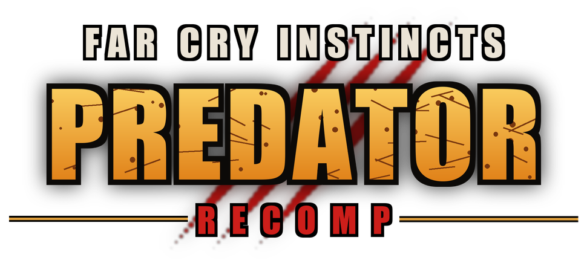

  

  

    <a href="https://github.com/bugcoder00/FarCryInstinctsPredatorRecomp/releases/latest">Download</a>
    •
    <a href="https://github.com/bugcoder00/FarCryInstinctsPredatorRecomp/issues">Report a bug</a>
  

  

A native PC port (Windows, DirectX 12) of *Far Cry Instincts Predator* (Xbox 360), made by **static
recompilation**: the game's PowerPC code is translated to C++ and runs natively, together with a custom runtime
(kernel, files, video, audio, input and network). The recompiler and the runtime were written from scratch.

- **Fully playable from start to finish.** Both campaigns, *Instincts* and *Evolution*, can be played through
  to the end, along with the map editor and System Link multiplayer.
- **Made for modest PCs.** The recomp was developed and tested on my own hardware, so it is optimized for low-end
  PCs with integrated graphics: on my laptop (integrated graphics, 8 GB of RAM) it holds **30 FPS at native
  720p**, even in the heaviest part of the game (the jungle in 02_Native).

> **Fan project, not affiliated with Ubisoft or Microsoft.**
> This repository and the release packages contain **no game files**. You need **your own original copy** of the
> Xbox 360 game. Do not ask for or post links to the game here.

## Features

**Launcher**
- Launcher in six languages: English, Portuguese, French, German, Spanish and Italian.
- Built-in Brazilian Portuguese translation of the game's texts (your copy's files are not changed).
- Plays straight from the disc **.iso** file, or from an extracted folder.
- Shows what your PC has and whether it meets the minimum requirements.

**Video options** (in the launcher, and in-game with **F2**, changed on the fly)
- Internal resolution from 1x (1280×720) up to 3x (3840×2160 / 4K).
- AMD FSR 1 upscaling with adjustable sharpness.
- Anti-aliasing: FXAA, MSAA (2x/4x/8x) and SMAA.
- 30, 45 or 60 FPS, and vertical sync.
- Field of view (FOV) slider and crosshair size.
- Sharper shadows, anisotropic texture filtering, longer draw distance and detail at a distance.
- Ambient occlusion.
- HDR (Auto HDR) and a "fake HDR" with more contrast and color for SDR screens.
- Widescreen and ultrawide (21:9 / 32:9) with the HUD kept in the center, or 16:9 with black bars.
- Graphics card choice (on laptops with two cards, the dedicated one is used by default).

**Progress and extras**
- **Achievements**: the game's own achievements pop up as you earn them, with a list and points in the launcher.
- **Profiles**: each profile has its own saved games and progress, and its own picture (an icon or your own image).
- **Save states**: save the exact point where you are in a level and go back to it anytime (F5 / F9 by default).
- **Cheats**: a CHEATS tab in the launcher turns them on with a description for each (all levels, all maps,
  invincible...), and the game's own cheat codes can be typed in the menu.

**Controls**
- Keyboard and mouse with raw mouse input, and the mouse works as a pointer in the menus.
- Controllers: Xbox, DualSense and DualShock 4 (USB or Bluetooth, no extra programs), plus generic controllers.
- Every key and button can be remapped (F1), with on-screen button icons that follow your keys.
- Split screen for up to 4 players.

**Multiplayer and map editor**
- System Link on the local network, and over the internet by typing the host's IP (the game opens the router
  ports by itself with UPnP).
- Voice chat in System Link, with a PC microphone and headset.
- The original map editor, with mouse support.

**Help with bugs**
- F12 saves a bug report (save, screenshot and logs) in one folder, ready to attach to an Issue.

## Play

1. Download the package from **Releases** and extract it to a writable folder (e.g. `Documents`).
2. Open `PredatorGame.exe`, and under **Game folder** pick the disc **.iso** file of **your** copy (USA/Europe
   version) or the folder with `default.xex` and the `.dat` files.
3. Click **Play**. The first start prepares the files and the graphics, so it takes about a minute longer.

**Requirements:** Windows 10/11 64-bit, a 4-core / 8-thread CPU, 8 GB of RAM and a DirectX 12 graphics card
(integrated graphics works). More details (controls, profiles, map editor, split screen, internet play) are in
`README.txt` inside the package.

## Support the project

If you'd like to support my work on the code, you can donate through
[PayPal](https://www.paypal.com/donate/?business=22ZK6H2MXX6CJ&no_recurring=0&currency_code=BRL). Donations are
entirely optional and support my time on the recompiler and the runtime only: they don't buy access to anything,
every release stays free for everyone, and the game itself remains the property of its owners.

## Found a problem?

Open an Issue. Press **F12** right when the problem shows up and attach the `bugs\bug_N` folder it creates next to
`PredatorGame.exe` (zipped). If the game closed or froze, attach `fcrecomp_log.txt` and `diagnostico.txt`.

## Build

Needs Visual Studio 2022 (C++), LLVM (clang-cl), CMake, Ninja and Python 3.

1. Build the recompiler: `PredatorRecomp\build.ps1`
2. Put the `default.xex` of your copy in `game\` and create the decrypted image with the release's
   `PredatorGame.exe`: `PredatorGame.exe --extrair-imagem game\default.xex game\image.bin`
3. Generate the game's C++ and build it: `PredatorRecomp\game\build_game.ps1`
   (map editor: `ige.xex` and `image.bin` in `editor\`, then `build_game.ps1 -Editor`)
4. `tools\empacotar.ps1` builds the release package.

The generated code (`PredatorRecomp\out`) belongs to the game and must **never** be published.
Diagnostic documentation (in Portuguese): `DIAGNOSTICO.md`.

## Special thanks

- **[Xenia](https://xenia.jp)**: the emulator was used only as a **comparison reference** to understand and fix
  some bugs. **No Xenia code is included in this project.**
- **[Claude Code](https://claude.com/claude-code)** (Anthropic): helped write the **PredatorRecomp** tool (the
  recompiler) and the runtime.

## License

Project code under the MIT license (`LICENSE`). *Far Cry* is a Ubisoft trademark; the game and its files belong to
their owners.
